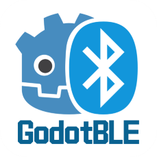

<div align="center">
  <h1>GDBLE - Godot Bluetooth Low Energy Plugin</h1>
<p>

</p>
<p>
    
    
    
    
  </p>
  <p><i>A modern Bluetooth Low Energy (BLE) plugin for Godot 4</i></p>
  <p>
    <a href="README.md">🇨🇳 中文</a> |
    <a href="README_EN.md">🇺🇸 English</a>
  </p>
</div>

---

## 📖 Table of Contents

- [Overview](#overview)
- [Features](#features)
- [Platform Support](#platform-support)
- [Installation](#installation)
- [Quick Start](#quick-start)
- [API Reference](#api-reference)
- [Complete Examples](#complete-examples)
- [Debug Mode](#debug-mode)
- [FAQ](#faq)
- [Data Format Description](#data-format-description)
- [Best Practices](#best-practices)
- [Performance Optimization Tips](#performance-optimization-tips)
- [Troubleshooting](#troubleshooting)
- [Contributing](#contributing)
- [License](#license)
- [Acknowledgments](#acknowledgments)
- [Contact](#contact)

---

## Overview

**Current version: 0.6.0 · Godot 4.2+**

See the [repair validation record](docs/REPAIR_VALIDATION.md) for completed checks and outstanding release acceptance. Release requires matching source provenance, final-addon smoke tests, and device evidence. `release_ready = false` in `BUILD_INFO.json` means the artifact set is incomplete.

A Rust BLE GDExtension for Godot 4.2+, built on btleplug 0.12.0. It supports scanning, connections, GATT discovery, reads, writes, and notifications while preserving the 0.5.x class names, method parameters, and legacy signals.

**Plugin Page**: [GDBLE - Godot Asset Library](https://godotengine.org/asset-library/asset/3439)

### Why Choose GDBLE?

- ✅ **Modern Architecture**: Built with Rust and async runtime for excellent performance
- ✅ **Real-time Response**: BLE requests run in the background
- ✅ **Common BLE Features**: Scan, connect, discover GATT, read, write, and notify
- ✅ **Easy to Use**: Clean GDScript API with signal-driven event system
- ✅ **Debuggable**: Structured events and a demo debugger for diagnosing operation failures

---

## Features

### Core Functionality

- 🔍 **Device Scanning**: Scan nearby BLE devices, get device name, address, and signal strength
- 🔗 **Device Connection**: Connect to specified BLE devices
- 🔎 **Service Discovery**: Discover GATT services and characteristics
- 📖 **Characteristic Reading**: Read characteristic values
- ✍️ **Characteristic Writing**: Write data to characteristics (with/without response)
- 🔔 **Notification Subscription**: Subscribe to characteristic notifications for real-time data
- 🎯 **Multi-device Management**: Manage multiple BLE device connections simultaneously

### Technical Features

- ⚡ **Async Execution**: The background core handles BLE requests; Godot getters read caches
- 🔒 **Thread Boundaries**: Background work holds no Godot objects; signals run on the main thread
- 📊 **Structured Events**: Operation IDs, stable error codes, and full GATT context
- 🐛 **Diagnostics**: Structured failures, operation deadlines, and compatible debug controls
- 🎮 **Compatibility**: Preserves 0.5.x class names, method parameters, and legacy signals

---

## Platform Support

| Platform | Architectures | Minimum | Validation scope and release gaps |
| --- | --- | --- | --- |
| Windows | x86_64 | Windows 10 | Native build, Godot loading, and fake-backend tests; physical BLE acceptance is separate |
| Linux | x86_64 | BlueZ/DBus runtime | Build and Godot loading; physical BlueZ/device acceptance is separate |
| macOS | x86_64, ARM64 | macOS 10.15 / 11 | Source checks pass; historical libraries still require native rebuilding and loading tests |
| Android | ARM64, x86_64 | API 23, compileSdk 34 | Both ABIs build and AAR structure is checked; ARM64 hardware BLE and x86_64 emulator acceptance remain outstanding |

This is not a complete hardware certification matrix. Recheck artifact provenance after every source change; see the [validation record](docs/REPAIR_VALIDATION.md) for current evidence. The development branch's `addons/gdble` may contain artifacts awaiting replacement and is not a complete cross-platform release. Asset Library entries should use a tag that has passed release acceptance.

Android ARMv7, iOS, and automatic reconnect are not supported in 0.6.0.

### Thread Safety

- The background BLE core owns the runtime, device sessions, and notification streams.
- Bounded channels carry commands and events; the Manager drains at most 256 queued events per frame.
- Godot objects and signals stay on the main thread, with caches updated before signals.

---

## Installation

### Method 1: Install from Asset Library (Recommended)

1. Open **AssetLib** in Godot Editor
2. Search for "GDBLE" or "Bluetooth"
3. Click download and install

### Method 2: Manual Installation

1. Download a package from [Releases](https://github.com/Fantety/GDBLE/releases).
2. Copy the complete `addons/gdble` directory into the same path in your project.
3. Restart the Godot editor and confirm the GDExtension loads.

The distribution has the following layout. Desktop platforms use their matching library; Android uses both AARs:

```text
your_project/
└── addons/
    └── gdble/
        ├── gdble.gdextension
        ├── gdble.gdap
        ├── permission_startup.gd
        ├── LICENSE
        ├── BUILD_INFO.json
        ├── SHA256SUMS
        ├── libgdble.windows.x86_64.dll
        ├── libgdble.linux.x86_64.so
        ├── libgdble.macos.x86_64.dylib
        ├── libgdble.macos.arm64.dylib
        └── android/
            ├── gdble-release.aar
            └── btleplug-release.aar
```

### Android Permissions and Export

The plugin declares but does not request permissions:

- API 23–30: `BLUETOOTH`, `BLUETOOTH_ADMIN`, `ACCESS_FINE_LOCATION`
- API 31+: `BLUETOOTH_SCAN`, `BLUETOOTH_CONNECT`

Check permissions first, then wait for permission callbacks and confirm the complete required set before initializing. Both demos reuse `permission_startup.gd`: denial leaves BLE uninitialized and returning to the foreground rechecks without repeatedly opening dialogs. Android is distributed as `gdble-release.aar` plus a separate `btleplug-release.aar`.

Android export requires Gradle Build, minSdk 23, and compileSdk 34; see the [Android build guide](docs/ANDROID_BUILD.md).

### Build from Source

`addons/gdble` is the only release source. Copy that directory into your Godot project. The Demo addon is generated by the build scripts instead of being maintained as a second copy.

```powershell
.\build.ps1
```

```bash
./build.sh
```

Android additionally requires JDK 17, Android SDK 34, the NDK, and `cargo-ndk`; see [Android build](docs/ANDROID_BUILD.md).

---

## Quick Start

### Basic Usage

The legacy call style remains valid. `connect_device()` only creates or returns a device handle; call `BleDevice.connect_async()` to connect.

```gdscript
extends Node

var bluetooth: BluetoothManager
var device: BleDevice

func _ready() -> void:
    bluetooth = BluetoothManager.new()
    add_child(bluetooth)
    bluetooth.adapter_initialized.connect(_on_initialized)
    bluetooth.device_discovered.connect(_on_discovered)
    bluetooth.ble_event.connect(_on_ble_event)

    var startup = preload("res://addons/gdble/permission_startup.gd").new()
    add_child(startup)
    startup.permission_denied.connect(func(missing):
        print("BLE remains uninitialized; enable permissions in Settings: ", missing))
    startup.start(bluetooth)

func _on_initialized(success: bool, error: String) -> void:
    if success:
        bluetooth.start_scan(10.0)
    else:
        push_error(error)

func _on_discovered(info: Dictionary) -> void:
    if info.get("name") == "My Device":
        bluetooth.stop_scan()
        device = bluetooth.get_or_create_device(info.address)
        device.connected.connect(func(): device.discover_services())
        device.connect_async()

func _on_ble_event(event: Dictionary) -> void:
    if event.terminal:
        print(event.operation_id, " ", event.operation, " -> ", event.phase)
```

`start_scan(0.0)` scans until `stop_scan()`; a positive value is a timed scan. Negative and non-finite values fail with `INVALID_ARGUMENT`. A duplicate start fails with `BUSY` without replacing the active scan.

---

## API Reference

### BluetoothManager

Bluetooth manager responsible for adapter initialization, device scanning, and connection management.

#### Methods

| Method | Parameters | Return | Description |
|--------|------------|--------|-------------|
| `initialize()` | None | int | Initialize Bluetooth adapter |
| `is_initialized()` | None | bool | Check if adapter is initialized |
| `get_adapter_info()` | None | Dictionary | Get cached adapter information |
| `start_scan(timeout_seconds)` | float | int | Start scanning for devices |
| `stop_scan()` | None | int | Stop scanning |
| `get_discovered_devices()` | None | Array[Dictionary] | Get list of discovered devices |
| `get_or_create_device(address)` | String | BleDevice | Create or return a device handle without connecting |
| `connect_device(address)` | String | BleDevice | Compatibility alias for `get_or_create_device()` |
| `disconnect_device(address)` | String | int | Disconnect specified device |
| `get_device(address)` | String | BleDevice | Get an existing device handle, which may be disconnected |
| `get_connected_devices()` | None | Array[BleDevice] | Get all connected devices |
| `set_debug_mode(enabled)` | bool | void | Enable/disable debug mode |
| `is_debug_mode()` | None | bool | Check debug mode status |

#### Signals

| Signal | Parameters | Description |
|--------|------------|-------------|
| `ble_event` | event: Dictionary | Structured operation event |
| `adapter_initialized` | success: bool, error: String | Adapter initialization complete |
| `device_discovered` | device_info: Dictionary | New device discovered |
| `device_updated` | device_info: Dictionary | Device information updated |
| `scan_started` | None | Scan started |
| `scan_stopped` | None | Scan stopped |
| `device_connecting` | address: String | Device connection initiated |
| `device_connected` | address: String | Device connected successfully |
| `device_disconnected` | address: String | Device disconnected |
| `error_occurred` | error_message: String | Error occurred |


### BleDevice

Represents a single BLE device, provides connection, service discovery, and data read/write functionality.

#### Methods

| Method | Parameters | Return | Description |
|--------|------------|--------|-------------|
| `connect_async()` | None | int | Asynchronously connect to device |
| `disconnect()` | None | int | Disconnect from device |
| `is_connected()` | None | bool | Check if connected |
| `get_address()` | None | String | Get device address |
| `get_name()` | None | String | Get device name |
| `discover_services()` | None | int | Discover device services |
| `get_services()` | None | Array[Dictionary] | Get discovered services list |
| `read_characteristic(service_uuid, char_uuid)` | String, String | int | Read characteristic value |
| `write_characteristic(service_uuid, char_uuid, data, with_response)` | String, String, PackedByteArray, bool | int | Write characteristic value |
| `subscribe_characteristic(service_uuid, char_uuid)` | String, String | int | Subscribe to characteristic notifications |
| `unsubscribe_characteristic(service_uuid, char_uuid)` | String, String | int | Unsubscribe from notifications |

#### Signals

| Signal | Parameters | Description |
|--------|------------|-------------|
| `ble_event` | event: Dictionary | Structured operation event |
| `connected` | None | Device connected successfully |
| `disconnected` | None | Device disconnected |
| `connection_failed` | error: String | Connection failed |
| `services_discovered` | services: Array | Service discovery complete |
| `characteristic_read` | char_uuid: String, data: PackedByteArray | Characteristic read complete |
| `characteristic_written` | char_uuid: String | Characteristic write complete |
| `characteristic_notified` | char_uuid: String, data: PackedByteArray | Characteristic notification received |
| `operation_failed` | operation: String, error: String | Operation failed |

Synchronous getters only read the main-thread cache. `get_or_create_device()` requires an initialized Manager and returns `null` for invalid addresses or an uninitialized adapter.

### Structured Events

Both public classes expose `ble_event(event: Dictionary)`:

| Field | Type | Meaning |
| --- | --- | --- |
| `operation` | StringName | initialize, scan, connect, disconnect, discover_services, read, write, subscribe, unsubscribe, notification, resolve_device |
| `phase` | StringName | started, progress, succeeded, failed, cancelled, received |
| `operation_id` | int | Positive for calls; `0` for unsolicited events such as remote disconnect |
| `terminal` | bool | Whether this operation ID has completed |
| `device_address` | String | Normalized identity, or empty |
| `service_uuid` | String | Canonical lowercase UUID, or empty |
| `characteristic_uuid` | String | Canonical lowercase UUID, or empty |
| `data` | Variant | Adapter, DeviceInfo, services, bytes, or reason text |
| `error` | Dictionary | Always contains `code/message/retryable/details` |

Methods that previously returned `void` now return an ignorable operation ID. Each positive ID receives exactly one terminal event while the Manager is alive and processing events; destroying it cancels background work without promising delivery of remaining events. `stop_scan()` cancels all scan requests submitted and still unfinished at the time of the call, including queued starts, and returns their oldest ID or `0` when none remain. It does not depend on the main thread having consumed an earlier scan's terminal event or on command queue capacity. Scans submitted after the stop call are unaffected.

Connect signals before calling methods. Invalid arguments, uninitialized standalone devices, and command queue rejections emit failure synchronously, before the method returns. A handler must not depend solely on an ID assigned after the call. Local rejections from a `BleDevice` are emitted by that device and are not forwarded to the Manager. Accepted requests complete asynchronously through the bounded event queue; the Manager forwards device events to the corresponding device. Caches update before structured and legacy signals, so synchronous getters inside callbacks see the corresponding state. Request rejection does not change an existing connection.

For scan progress events, the DeviceInfo `data` also contains `kind: StringName` with `discovered` or `updated`.

New stable errors include `INVALID_ARGUMENT`, `NOT_INITIALIZED`, `BUSY`, `QUEUE_FULL`, `CANCELLED`, `ANDROID_NOT_INITIALIZED`, `AMBIGUOUS_CHARACTERISTIC`, `ADAPTER_UNAVAILABLE`, `EVENT_OVERFLOW`, and `SERVICES_CHANGED`. Legacy error signals keep their compatibility text.

Admission reserves capacity for both started and terminal events. Reservation failure synchronously returns `QUEUE_FULL` without executing backend work. Command capacity remains 64, outbound event capacity 1024, and the per-frame budget 256. Control and high-rate data use separate channels. Congested scan updates coalesce by device and evict the oldest pending update with `EVENT_OVERFLOW`. Non-request failures have `operation_id = 0`, `terminal = false`. Repeated unsolicited state changes may coalesce to the latest state under pressure; request outcomes never coalesce.

Subscriptions use the full `(service_uuid, characteristic_uuid)` key and each device has one notification pump. Since btleplug notifications omit the service UUID, subscribing to the same characteristic UUID under two services fails with `AMBIGUOUS_CHARACTERISTIC`. On a connected session whose GATT state has not been invalidated, unsubscribing an inactive full GATT key succeeds idempotently with `data = "already_unsubscribed"`, without calling the backend or affecting another service's subscription. A failed unsubscribe of an active key retains that subscription.

The notification receiver is ready before backend subscribe starts. Preparation buffers at most 64 values / 64 KiB per device; subscription success precedes buffered delivery. Any notification overflow reports `EVENT_OVERFLOW` (`error.details.source` identifies the buffer), stops that device's pump, and clears undelivered data while preserving the connection. The application must subscribe again. Notification failures also project to legacy `operation_failed`.

Power-off or unknown adapter state emits a nonterminal `initialize` failure with `ADAPTER_UNAVAILABLE` and `error.details.state` (`powered_off` or `unknown`), invalidates initialization, and cancels scan/device work. Power-on emits `initialize` progress with the String `data = "powered_on"`; explicitly initialize again. Service changes report `SERVICES_CHANGED`, clear GATT/subscription caches, and require discovery before resubscribing. No automatic reconnect is performed.

See the [API contract](docs/API_CONTRACT.md) for per-operation payloads, the complete error code list, request correlation, and object lifetimes.

---

## Complete Examples

The runnable [demo](demo) now opens a Chinese-language BLE debugger with multiple device connections, arbitrary GATT browsing, HEX/UTF-8 reads and writes, notification subscriptions, and filtered logs. It uses desktop split panes and mobile tabs. Open `demo/project.godot` in Godot 4.2+ and run the project; see the [Demo guide](demo/DEMO_GUIDE.md) for setup and permissions. The original [console example](demo/examples/console.tscn) and [commented example](demo/examples/commented.tscn) remain separate learning entry points. The following code examples assume Bluetooth permissions have been granted. Replace names and UUIDs with those of your device.

### Example 1: Scan and Connect to Device

```gdscript
extends Node

var bluetooth_manager: BluetoothManager
var target_device_name = "MyDevice"

func _ready():
    bluetooth_manager = BluetoothManager.new()
    add_child(bluetooth_manager)

    bluetooth_manager.adapter_initialized.connect(_on_initialized)
    bluetooth_manager.device_discovered.connect(_on_device_found)
    bluetooth_manager.scan_stopped.connect(_on_scan_done)

    bluetooth_manager.initialize()

func _on_initialized(success: bool, error: String):
    if success:
        bluetooth_manager.start_scan(10.0)

func _on_device_found(info: Dictionary):
    var name: String = info.get("name") if info.get("name") != null else ""
    if name == target_device_name:
        print("Target device found!")
        bluetooth_manager.stop_scan()
        connect_to_target(info.get("address"))


func _on_scan_done():
    print("Scan complete")

func connect_to_target(address: String):
    var device = bluetooth_manager.connect_device(address)
    if device:
        device.connected.connect(_on_connected)
        device.connect_async()

func _on_connected():
    print("Device connected!")
```

### Example 2: Read Sensor Data

```gdscript
extends Node

var bluetooth_manager: BluetoothManager
var sensor_device: BleDevice

# Standard Heart Rate Service UUID
const HEART_RATE_SERVICE = "0000180d-0000-1000-8000-00805f9b34fb"
const HEART_RATE_MEASUREMENT = "00002a37-0000-1000-8000-00805f9b34fb"

func _ready():
    bluetooth_manager = BluetoothManager.new()
    add_child(bluetooth_manager)

    bluetooth_manager.adapter_initialized.connect(_on_initialized)
    bluetooth_manager.device_discovered.connect(_on_device_found)

    bluetooth_manager.initialize()

func _on_initialized(success: bool, error: String):
    if success:
        bluetooth_manager.start_scan(10.0)

func _on_device_found(info: Dictionary):
    # Look for heart rate monitor
    var name: String = info.get("name") if info.get("name") != null else ""
    if "Heart" in name or "HR" in name:
        bluetooth_manager.stop_scan()
        connect_to_sensor(info.get("address"))

func connect_to_sensor(address: String):
    sensor_device = bluetooth_manager.connect_device(address)
    if sensor_device:
        sensor_device.connected.connect(_on_sensor_connected)
        sensor_device.services_discovered.connect(_on_services_found)
        sensor_device.characteristic_notified.connect(_on_heart_rate_update)
        sensor_device.connect_async()

func _on_sensor_connected():
    print("Sensor connected")
    sensor_device.discover_services()

func _on_services_found(services: Array):
    # Subscribe to heart rate notifications
    sensor_device.subscribe_characteristic(HEART_RATE_SERVICE, HEART_RATE_MEASUREMENT)

func _on_heart_rate_update(char_uuid: String, data: PackedByteArray):
    if char_uuid.to_lower() == HEART_RATE_MEASUREMENT:
        # Parse heart rate data (simplified)
        if data.size() > 1:
            var heart_rate = data[1]
            print("Current heart rate: ", heart_rate, " BPM")
```


### Example 3: Control Smart Light Bulb

```gdscript
extends Node

var bluetooth_manager: BluetoothManager
var light_device: BleDevice

# Custom service UUID (example)
const LIGHT_SERVICE = "0000fff0-0000-1000-8000-00805f9b34fb"
const LIGHT_CONTROL = "0000fff2-0000-1000-8000-00805f9b34fb"

func _ready():
    bluetooth_manager = BluetoothManager.new()
    add_child(bluetooth_manager)

    bluetooth_manager.adapter_initialized.connect(_on_initialized)
    bluetooth_manager.device_discovered.connect(_on_light_found)
    bluetooth_manager.initialize()

func _on_initialized(success: bool, error: String):
    if success:
        bluetooth_manager.start_scan(10.0)

func _on_light_found(info: Dictionary):
    if info.get("name") == "MyLight":
        bluetooth_manager.stop_scan()
        connect_to_light(info.address)

func connect_to_light(address: String):
    light_device = bluetooth_manager.connect_device(address)
    if light_device:
        light_device.connected.connect(_on_light_connected)
        light_device.services_discovered.connect(_on_services_found)
        light_device.characteristic_written.connect(_on_command_sent)
        light_device.connect_async()

func _on_light_connected():
    print("Light bulb connected")
    light_device.discover_services()

func _on_services_found(services: Array):
    print("Service discovery complete, ready to control light")

func set_light_color(red: int, green: int, blue: int):
    # Construct color command (example format)
    var command = PackedByteArray([0x01, red, green, blue])
    light_device.write_characteristic(LIGHT_SERVICE, LIGHT_CONTROL, command, false)

func turn_on():
    var command = PackedByteArray([0x02, 0x01])
    light_device.write_characteristic(LIGHT_SERVICE, LIGHT_CONTROL, command, false)

func turn_off():
    var command = PackedByteArray([0x02, 0x00])
    light_device.write_characteristic(LIGHT_SERVICE, LIGHT_CONTROL, command, false)

func _on_command_sent(char_uuid: String):
    print("Command sent")

# Called from UI
func _on_red_button_pressed():
    set_light_color(255, 0, 0)

func _on_green_button_pressed():
    set_light_color(0, 255, 0)

func _on_blue_button_pressed():
    set_light_color(0, 0, 255)
```

---

## Debug Mode

The `set_debug_mode()` / `is_debug_mode()` compatibility flag remains available; it does not enable an additional native logging stream. To diagnose operation results, log `ble_event` from the Manager and device (accepted device events appear on both, so deduplicate when aggregating):

```gdscript
bluetooth_manager.set_debug_mode(OS.is_debug_build())
bluetooth_manager.ble_event.connect(_on_ble_event)
# Connect the device signal after obtaining a handle, before submitting work
device.ble_event.connect(_on_ble_event)

func _on_ble_event(event: Dictionary):
    print(event.operation_id, " ", event.operation, " -> ", event.phase)
    if event.phase == &"failed" or event.phase == &"cancelled":
        push_warning(str(event.error))
```

Disable the compatibility debug flag with `bluetooth_manager.set_debug_mode(false)`. Logging in the handler above is controlled by the application.

---

## FAQ

### Q: Why can't I find any devices?

**A:** Please check:

1. Ensure Bluetooth adapter is enabled
2. Ensure target device is in advertising state
3. Check if device is within range (usually within 10 meters)
4. Log `ble_event` or use the demo debugger to inspect failures

### Q: What if device connection fails?

**A:** Possible reasons:

1. Device is already connected by another application
2. Device is out of range
3. Device battery is low
4. Pairing required but not paired

### Q: How to handle device disconnection?

**A:** Listen to the `disconnected` signal:

```gdscript
device.disconnected.connect(_on_device_disconnected)

func _on_device_disconnected():
    print("Device disconnected, attempting reconnection...")
    # Implement reconnection logic
```

### Q: Write operation has no response?

**A:** Check:

1. Does characteristic support write (check `properties.write`)
2. Is data format correct
3. Do you need to use `with_response` parameter
4. Inspect the code and details in `ble_event.error`

### Q: How to find correct service and characteristic UUIDs?

**A:**

1. Check device documentation or specifications
2. Inspect services through `services_discovered`
3. Use standard BLE services (e.g., heart rate, battery)
4. Use third-party BLE scanning tools (e.g., nRF Connect)

### Q: Does it support connecting to multiple devices simultaneously?

**A:** Yes, GDBLE supports managing multiple device connections:

```gdscript
var device1 = bluetooth_manager.connect_device(address1)
var device2 = bluetooth_manager.connect_device(address2)
if device1:
    device1.connect_async()
if device2:
    device2.connect_async()
```


### Q: How's the performance? Will it affect game frame rate?

**A:** GDBLE uses async architecture, BLE requests run in the background and the Manager drains at most 256 queued events per frame. Application signal handlers still need to stay short, and destroying the Manager waits for bounded cleanup.

### Q: Why does a Manager listener miss a device's argument error?

Device-local rejections are emitted synchronously by that device. Connect its `ble_event` before calling methods; accepted operations are delivered asynchronously through the Manager.

---

## Data Format Description

### DeviceInfo Dictionary

The following describes field types; `name`, `rssi`, and `tx_power_level` may be `null`:

```gdscript
{
    "address": String,
    "name": String | null,
    "rssi": int | null,
    "services": Array[String],
    "manufacturer_data": Dictionary,
    "service_data": Dictionary,
    "tx_power_level": int | null,
}
```

### Service Dictionary

Service dictionary contains the following fields:

```gdscript
{
    "uuid": String,                    # Service UUID
    "characteristics": Array[Dictionary]  # Characteristics list
}
```

### Characteristic Dictionary

Characteristic dictionary contains the following fields:

```gdscript
{
    "uuid": String,        # Characteristic UUID
    "properties": {        # Characteristic properties
        "read": bool,                    # Can read
        "write": bool,                   # Can write (with response)
        "write_without_response": bool,  # Can write (without response)
        "notify": bool,                  # Supports notifications
        "indicate": bool                 # Supports indications
    }
}
```

---

## Best Practices

### 1. Error Handling

Always handle error cases:

```gdscript
bluetooth_manager.adapter_initialized.connect(func(success, error):
    if not success:
        push_error("Bluetooth initialization failed: " + error)
        # Show error message to user
)

device.connection_failed.connect(func(error):
    push_error("Connection failed: " + error)
    # Retry or notify user
)
```

### 2. Resource Cleanup

Clean up resources when node is destroyed:

```gdscript
func _exit_tree():
    if device and device.is_connected():
        device.disconnect()
    if bluetooth_manager:
        bluetooth_manager.stop_scan()
```

### 3. Timeout Handling

Backend initialization, scan start/stop, and device operations each have a 30-second deadline and fail with `TIMEOUT`; backend Rust panics become `INTERNAL_ERROR`. Deadlines start when backend execution starts, excluding queue and event delivery time. They do not limit normal scan or notification stream lifetime. Shutdown cancels tracked work, then attempts scan stop and device disconnects within a shared two-second cleanup budget, followed by a 100 ms runtime shutdown grace period. A blocking system call cannot be preempted by an async deadline, and cancelling a future does not necessarily undo effects already applied by the OS.

Unexpected adapter stream termination invalidates initialization, cancels scan/device work, and emits a nonterminal `initialize` failure with operation ID `0`. Call `initialize()` again after the bounded cleanup. Unexpected notification stream termination emits a nonterminal `notification` failure; subscribing again restarts that device's stream. Generation checks ignore events from old sessions. There is no automatic reconnect.

### 4. State Management

Maintain clear connection state:

```gdscript
enum DeviceState {
    DISCONNECTED,
    CONNECTING,
    CONNECTED,
    DISCOVERING_SERVICES,
    READY
}

var device_state = DeviceState.DISCONNECTED

func connect_device(address: String):
    device_state = DeviceState.CONNECTING
    device = bluetooth_manager.connect_device(address)
    # ...

func _on_connected():
    device_state = DeviceState.CONNECTED
    device.discover_services()
    device_state = DeviceState.DISCOVERING_SERVICES

func _on_services_discovered(services: Array):
    device_state = DeviceState.READY
    # Now ready for read/write operations
```

### 5. Data Validation

Validate received data:

```gdscript
func _on_characteristic_read(char_uuid: String, data: PackedByteArray):
    if data.size() == 0:
        push_warning("Received empty data")
        return

    if data.size() < expected_size:
        push_warning("Data length insufficient")
        return

    # Process data
    process_data(data)
```

---

## Performance Optimization Tips

### 1. Scan Optimization

```gdscript
# Use appropriate scan time
bluetooth_manager.start_scan(5.0)  # 5 seconds is usually enough

# Stop scanning immediately after finding target device
func _on_device_discovered(info: Dictionary):
    if info.get("name") == target_name:
        bluetooth_manager.stop_scan()
```

### 2. Write Optimization

```gdscript
# For data that doesn't need confirmation, use write without response
device.write_characteristic(service, char, data, false)  # Faster

# For important data, use write with response
device.write_characteristic(service, char, data, true)   # More reliable
```

### 3. Notification Optimization

```gdscript
# Only subscribe to needed characteristics
device.subscribe_characteristic(service, char)

# Unsubscribe when no longer needed
device.unsubscribe_characteristic(service, char)
```

---

## Troubleshooting

### Enable Detailed Logging

```gdscript
bluetooth_manager.set_debug_mode(true)
```

### Check Adapter Status

```gdscript
if not bluetooth_manager.is_initialized():
    print("Adapter not initialized")
```

### Verify Device Connection

```gdscript
if device and device.is_connected():
    print("Device connected")
else:
    print("Device not connected")
```

### View Discovered Services

```gdscript
func _on_services_discovered(services: Array):
    print("Discovered services:")
    for service in services:
        print("  Service: ", service.get("uuid"))
        for char in service.get("characteristics", []):
            print("    Characteristic: ", char.get("uuid"))
            print("    Properties: ", char.get("properties"))
```

---

## Contributing

Contributions, issue reports, and suggestions are welcome!

- Report Issues: [GitHub Issues](https://github.com/Fantety/GDBLE/issues)
- Submit Code: [Pull Requests](https://github.com/Fantety/GDBLE/pulls)

### Development and Releases

```bash
cargo fmt --all -- --check
cargo clippy --all-targets --all-features --locked -- -D warnings
cargo test --all-targets --all-features --locked
```

See [CONTEXT.md](CONTEXT.md), [architecture decisions](docs/adr), [Issues](https://github.com/Fantety/GDBLE/issues), and [Pull Requests](https://github.com/Fantety/GDBLE/pulls).

Maintainers should follow the [two-phase release process](docs/RELEASING.md). Keep versioned release notes in [release-notes](release-notes); GitHub Actions reads the Markdown file matching the tag, without per-release workflow edits.

---

## License

This project is licensed under the MIT License. See [LICENSE](LICENSE) file for details.

---

## Acknowledgments

- [btleplug](https://github.com/deviceplug/btleplug) - Excellent Rust BLE library
- [godot-rust](https://github.com/godot-rust/gdext) - Godot Rust bindings
- Godot community for support and feedback

---

## Contact

- GitHub: [@Fantety](https://github.com/Fantety)
- Project Homepage: [GDBLE](https://github.com/Fantety/GDBLE)

---

<div align="center">
  <p>If this project helps you, please give it a ⭐️ Star!</p>
  <p>Made with ❤️ for Godot Community</p>
</div>
